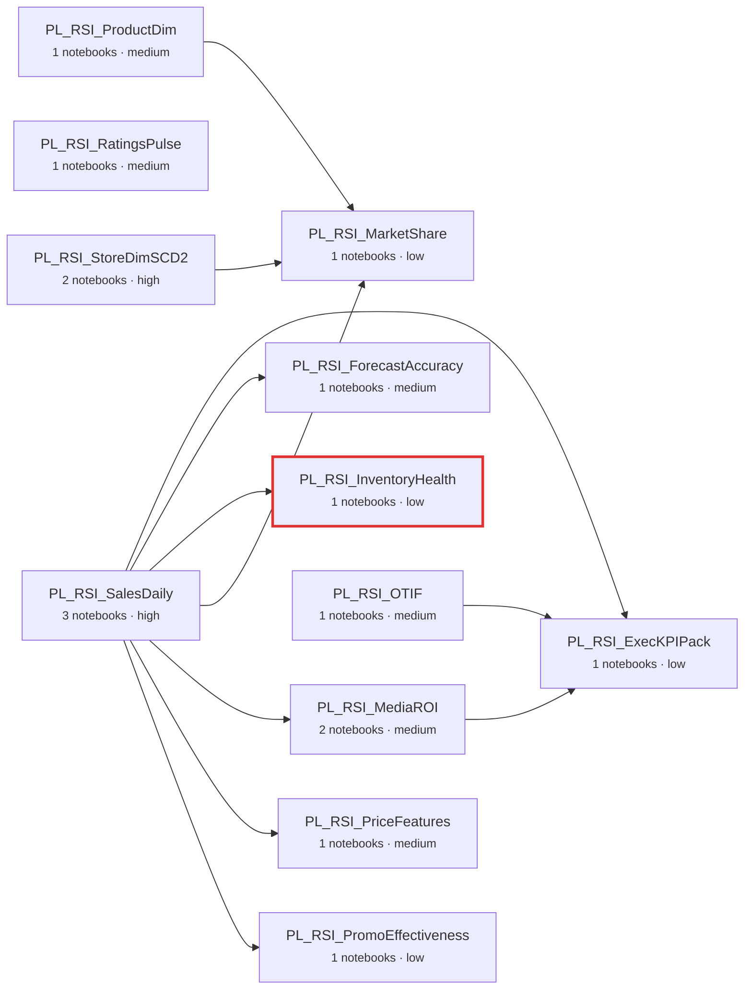

# Migration scope: pds-rsi (Retail Sales Intelligence)

Source: **Azure Data Factory** + **Azure Databricks (PySpark, Delta Lake)**. Target: **Cloud Composer (Airflow 2)** + **BigQuery**.

| Pipelines | Notebooks | Triggers | Linked services | Migration units | Waves |
|---|---|---|---|---|---|
| 16 | 17 | 2 | 6 | 12 | 3 |

## Data lineage between migration units

## Migration units

| Unit | Pipeline(s) | Notebooks | Writes | Upstream | Complexity | Notable constructs |
|---|---|---|---|---|---|---|
| `execkpipack` | PL_RSI_ExecKPIPack | nb_exec_kpi_pack | gold_exec_kpi_monthly | mediaroi, otif, salesdaily | low (8) |  |
| `forecastaccuracy` | PL_RSI_ForecastAccuracy | nb_forecast_accuracy | gold_forecast_accuracy | salesdaily | medium (14) | week_trunc, window_fn |
| `inventoryhealth` | PL_RSI_InventoryHealth | nb_inventory_cover | gold_inventory_health | salesdaily | low (10) | window_fn |
| `marketshare` | PL_RSI_MarketShare | nb_market_share | gold_market_share | productdim, salesdaily, storedimscd2 | low (10) | sql_magic, window_fn |
| `mediaroi` | PL_RSI_MediaROI | nb_media_weekly, nb_media_roi | gold_media_roi, silver_media_weekly | salesdaily | medium (18) | dynamic_sql, pivot, week_trunc |
| `otif` | PL_RSI_OTIF, PL_RSI_OTIF_Region | nb_otif_kpis | gold_otif | - | medium (13) | replace_where |
| `pricefeatures` | PL_RSI_PriceFeatures | nb_price_features | feat_price_elasticity | salesdaily | medium (12) | week_trunc, window_fn |
| `productdim` | PL_RSI_ProductDim | nb_product_dim | dim_product | - | medium (12) | hashing, python_udf |
| `promoeffectiveness` | PL_RSI_PromoEffectiveness | nb_promo_uplift | gold_promo_uplift | salesdaily | low (8) |  |
| `ratingspulse` | PL_RSI_RatingsPulse | nb_ratings_pulse | gold_ratings_pulse | - | medium (12) | range_window, window_fn |
| `salesdaily` | PL_RSI_SalesDaily, PL_RSI_Sales_FxConvert, PL_RSI_Sales_Cleanse | nb_sales_daily_agg, nb_sales_fx_convert, nb_sales_cleanse | gold_sales_daily, silver_sales, silver_sales_eur | - | high (27) | as_of_join, window_fn |
| `storedimscd2` | PL_RSI_StoreDimSCD2 | nb_store_dim_init, nb_store_dim_scd2 | dim_store | - | high (23) | date_format, dynamic_sql, merge_scd2, notebook_chaining, window_fn |

## Findings

- **medium** `forecastaccuracy` (semantic_trap): Spark date_trunc('week') is Monday-based; BigQuery DATE_TRUNC(.., WEEK) is Sunday-based -> use WEEK(MONDAY).
- **high** `inventoryhealth` (race_condition): PL_RSI_InventoryHealth reads pds_rsi.silver_sales produced by PL_RSI_SalesDaily but the master pipeline runs them in parallel (no dependsOn). Target DAG must add salesdaily >> inventoryhealth.
- **medium** `mediaroi` (semantic_trap): Spark date_trunc('week') is Monday-based; BigQuery DATE_TRUNC(.., WEEK) is Sunday-based -> use WEEK(MONDAY).
- **medium** `pricefeatures` (semantic_trap): Spark date_trunc('week') is Monday-based; BigQuery DATE_TRUNC(.., WEEK) is Sunday-based -> use WEEK(MONDAY).
- **medium** `productdim` (python_udf): Python UDFs must be rewritten as BigQuery SQL expressions (or SQL UDFs).

## Execution waves (data lineage order)

0. otif, productdim, ratingspulse, salesdaily, storedimscd2
1. forecastaccuracy, inventoryhealth, marketshare, mediaroi, pricefeatures, promoeffectiveness
2. execkpipack
